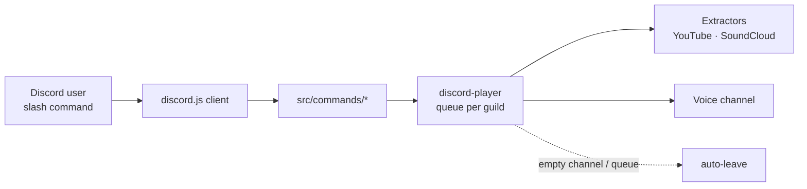

<div align="center">


# Marola Beat

### Self-hosted Discord music bot for the Marola RP community

Slash commands, a shared queue and YouTube + SoundCloud playback, in a small TypeScript codebase
that is easy to read and extend.

[](https://n3xus.dev)
[](https://marolaroleplay.com.br)
[](LICENSE)

[](tsconfig.json)
[](package.json)
[](package.json)
[](src/player.ts)
[](package.json)

</div>

---

## Table of Contents

- [Overview](#overview)
- [Commands](#commands)
- [Architecture](#architecture)
- [Quickstart](#quickstart)
- [Repository structure](#repository-structure)
- [Current status](#current-status)

---

## Overview

**Marola Beat** plays music in the voice channels of the Marola RP Discord. It was written to be boring in the
good way: one process, slash commands only, nothing stored, and it leaves the channel when nobody is listening.

It is built for:

- community servers that want their own music bot instead of a shared public one;
- developers learning `discord.js` + `discord-player` from a small, typed example;
- self-hosting on a VPS or in a container next to other community services.

---

## Commands

| Command | What it does |
|---|---|
| `/play <query>` | Search or paste a URL; adds the track or playlist to the queue |
| `/skip` · `/stop` | Skip the current track · stop and clear the queue |
| `/pause` · `/resume` | Pause or resume playback |
| `/queue` · `/nowplaying` | Show the queue · show the current track |
| `/shuffle` | Shuffle the remaining tracks |
| `/loop <off\|track\|queue>` | Set the repeat mode |

---

## Architecture



---

## Quickstart

Requires Node.js 18+ and a Discord application with a bot user.

```bash
git clone https://github.com/Samurai33/Marola-Beat.git
cd Marola-Beat
cp .env.example .env        # DISCORD_TOKEN, DISCORD_APP_ID, GUILD_ID
npm install
npm run register            # registers the slash commands in your guild
npm run dev
```

Production:

```bash
npm run build
npm start
```

---

## Repository structure

| Path | What it is |
|---|---|
| `src/index.ts` | Bot entry point and command routing |
| `src/player.ts` | discord-player setup, extractors and auto-leave events |
| `src/commands/` | One file per slash command |
| `src/register-commands.ts` | Registers the commands for `GUILD_ID` |
| `.env.example` | Required environment variables |

---

## Current status

| | |
|---|---|
| **Stage** | Working v1, open source |
| **Successor** | A private v2 runs in production for Marola RP (Docker image + Coolify) |
| **Not included** | Persistence, web dashboard, tests |

---

<div align="center">

**Need something built, secured or kept online?** → [contato@n3xus.dev](mailto:contato@n3xus.dev) · [n3xus.dev](https://n3xus.dev)

MIT © Thiago "Samurai" Rangel · [N3XUS](https://n3xus.dev)

</div>
